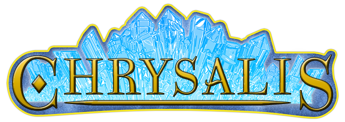

Chrysalis Game Data
####################

This repository contains the scenario and media files for the `Chrysalis Roleplay Games <https://chrysalis-game.com/>`_:

- Descent (one-shot table-top RPG)
- Mindstorm (single-day mystery party)
- Archives (single-evening mystery party)
- Auction (alternate reality game, mixing live encounters and web interactions)

You may freely modify, use and share these assets under the `Creative Commons - Non Commercial <https://creativecommons.org/licenses/by-nc/3.0/fr/deed.en>`_ license. Their authors are listed in the `team page <https://chrysalis-game.com/cms/a-propos/equipe/>`_ of the Chrysalis Game website. For commercial use of media or text files, please contact us via this website. Python code files, on the other hand, are released under a permissive `MIT license <https://opensource.org/licenses/MIT>`_.

Chrysalis texts were written in French; English translations are available for all games (see `Generation of PDF scenario files and other documents`_ below).

Use with the Pychronia Portal
========================================

Most of this content can be loaded into a web portal called Pychronia, for use in an online context with per-player user accounts.

See the `repository of the Pychronia portal <https://github.com/ChrysalisTeam/pychronia/>`_, and especially its "GETTING_STARTED.txt" doc, for more information.

A demo of the portal (with chrysalis game data loaded) is available on the Chrysalis Game website.

Generation of PDF scenario files and other documents 
=======================================================

The "docs/" subfolder contains python scripts to automatically generate PDF documents for the games of the Chrysalis universe, while checking scenario consistency along the way.

To know more about these utilities, see the article `Assisted script writing, with Pychronia Tools <https://medium.com/@pakaldebonchamp/assisted-script-writing-with-pychronia-tools-92dc6809e1de>`_.

You can use these utilities, especially the "rpg_sheet_generator.py" mini-lib, to produce your own auto-validated story files from `restructuredtext <http://docutils.sourceforge.net/rst.html>`_ files.

Note that output folders will contain restructuredtext files along their PDF counter-parts, so that you may debug in case of PDF conversion errors, or fallback to manual `rst2pdf <https://github.com/rst2pdf/rst2pdf>`_ invocation if needed.

Common setup
---------------

Create a python virtual environments (see https://virtualenv.pypa.io/en/latest/) and **activate it**; python 3.13 has been tested, other recent python3 versions should work too.

Then install common dependencies, from inside the root folder of the repository::

	pip install -r requirements.txt
	
Build scripts can then be run from any folder, but their paths are relative to the tooling folder::

	cd docs/

All build scripts accept a ``--lang fr|en`` option (French by default), to choose the language of the script fixtures to use: French sources are unsuffixed or have a "_fr" suffix, English ones have an "_en" suffix (see "script_fixtures/TRANSLATION_GLOSSARY_FR_EN.rst").
The generated documents then go into the "docs/output_<game>/<language>/" folder. Use ``--help`` for details.

The data of the "Chrysalis:Auction" alternate reality game (loaded by the Pychronia web portal, and partly reused by mystery parties) lives in "alternate_reality_game_auction/scenario_fixtures/" (its media, served by the Pychronia portal, are in the other subfolders of "alternate_reality_game_auction/"): each YAML file there has a French "_fr" version and an English "_en" one, except language-neutral files like "global_data.yaml". The Pychronia game picks the files of the language chosen when a game instance is created.

Under pytest, use the CHRYSALIS_LANG (eg. "en") and CHRYSALIS_WITH_CLUES (eg. "1") environment variables instead of these options.

Chrysalis:Descent
---------------------

Run::

	python build_descent_pdfs.py --lang en

The "docs/output_descent/en/" folder should then contain the gamemaster manual, and character sheets, for this tabletop roleplay game.

They are meant to be used along the assets of the "descent_media/" folder.

Chrysalis:Mindstorm
---------------------

Run::
	
	python build_mindstorm_pdfs.py --lang en --with-clues

This script requires a "script_fixtures/local.yaml" file, with the data specific to your own mystery party (see "local.yaml.example").

It also relies on the presence of an "docs/_initial_game_data_dump.yaml" file, a dump of the data stored in the pychronia portal database, which includes some useful scenario texts. This dump is not translated yet, so English documents still contain some French texts from it.

If this yaml file is not present, the script will attempt to generate it using the Pychronia code, so ensure that the Pychronia repository root is added to your PYTHONPATH.
In case the generation of this dump fails, you can also initialize and run the Pychronia portal normally, and copy/paste the yaml data from the "database content" page of the gamemaster area of your game into this dump file.
The Pychronia portal should be in default Auction mode for this dumping (see "persistent_mode_settings.py" files), since the build script overrides relevant values of the mystery-party when needed.

The build_mindstorm_pdfs.py PDF generation script is quite long to run, so you might want to disable some steps later in it (by replacing some "if True:" by "if False:"), to regenerate only what you need.

The "docs/output_mindstorm/en/" folder should then contain the gamemaster manual, character sheets, summary docs, and in-game documents for this mystery party game.

If you have put properly named images (eg. "Amethyst-John Doe.jpg", with the "real_life_identity" fields of characters in the game data dump) in "docs/trombinoscope/" folder, the generated common_guests_gallery.pdf file will gather them; else, the avatars of characters are used.

With the ``--with-clues`` option, you'll need to have LibreOffice installed in your system, so that separate documents can be extracted from the "ingame_clues_<game>.odt" file (or its "ingame_clues_<game>_en.odt" translation) using "unoconv.py".
This step might fail if the pagination of this ODT file is altered on your system (e.g. fonts missing), in this case edit it by hand to respect the splitting information stored in the INGAME_CLUES_PARTS python variable of the build script.
English and French documents share this splitting information, so translations must keep the pagination of the French document; the build checks that the first page of each clue contains the text snippet declared for it, in INGAME_CLUES_PARTS, so that page shifts can't go unnoticed.

Chrysalis:Archives
---------------------

Run::

	python build_archives_pdfs.py --lang en --with-clues

The "docs/output_archives/en/" folder should then contain the gamemaster manual, and character sheets, for this mystery party.

See instructions for "Chrysalis:Mindstorm" above, for some constraints and possibilities of this build system.

Chrysalis:Auction
---------------------

Run::

	python build_auction_pdfs.py --lang en

The "docs/output_auction/en/" folder should then contain the whole gamemaster manual for this alternate reality game, as well as a preview version with only a few pages (in which links to missing sections are turned into plain text).

These documents are meant to be used with the different media of this repository, as well as the Pychronia portal, to master the adventure.

