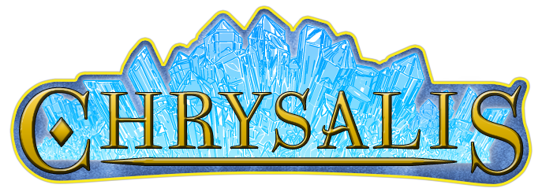

Chrysalis Game Data
####################

This repository contains the scenario and media files for the `Chrysalis Roleplay Games <https://chrysalis-game.com/>`_:

- Descent (one-shot table-top RPG)
- Sentience (table-top RPG, playing "sapient" animals)
- Skeletons (table-top RPG, playing animated skeletons)
- Mindstorm (single-day mystery party)
- Archives (single-evening mystery party)
- Cromlech (two-hour mystery party, for all audiences)
- Auction (alternate reality game, mixing live encounters and web interactions)

You may freely modify, use and share these assets under the `Creative Commons - Non Commercial <https://creativecommons.org/licenses/by-nc/3.0/fr/deed.en>`_ license. Their authors are listed in the `team page <https://chrysalis-game.com/cms/a-propos/equipe/>`_ of the Chrysalis Game website. For commercial use of media or text files, please contact us via this website. Python code files, on the other hand, are released under a permissive `MIT license <https://opensource.org/licenses/MIT>`_.

Chrysalis texts were written in French; English translations are available for all games except Skeletons (see `Generation of PDF scenario files and other documents`_ below).

Each game has its own root folder ("alternate_reality_game_auction/", "mysteryparty_archives/", "mysteryparty_cromlech/", "mysteryparty_mindstorm/", "rpg_descent/", "rpg_sentience/", "rpg_skeletons/"), which contains its media files, and its scenario sources in a "scenario_fixtures/" subfolder. "mysteryparty_common/" gathers the sources shared by mystery parties, and "common_assets/" the assets and tools shared by several games (PDF theme, fonts, game data dump, translation glossary...).

Generation of PDF scenario files and other documents
=======================================================

The PDF documents of the games of the Chrysalis universe (gamemaster manuals, character sheets, in-game documents, inventories...) are generated by `Pychronia-storygen <https://github.com/ChrysalisTeam/pychronia-storygen>`_, which also checks scenario consistency along the way. Each game has a storygen project folder, containing a "configuration.yaml" file (or "configuration_<language>.yaml" ones) which describes the documents to build, and the restructuredtext/jinja2 templates they are made of.

To know more about these utilities, see the article `Assisted script writing, with Pychronia Tools <https://medium.com/@pakaldebonchamp/assisted-script-writing-with-pychronia-tools-92dc6809e1de>`_, and the README of Pychronia-storygen (which details the configuration format).

You can use storygen to produce your own auto-validated story files from `restructuredtext <http://docutils.sourceforge.net/rst.html>`_ files.

Note that "_build/" folders will contain restructuredtext files along the PDF counter-parts of "_output/" folders, so that you may debug in case of PDF conversion errors, or fallback to manual `rst2pdf <https://github.com/rst2pdf/rst2pdf>`_ invocation if needed.

Common setup
---------------

Create a python virtual environment (see https://virtualenv.pypa.io/en/latest/) and **activate it**; python 3.13 has been tested, other recent python3 versions (3.11+) should work too.

Install the requirements of this repository in it, from its root folder::

	pip install -r requirements.txt

This installs Pychronia-storygen from its git repository (it brings its own dependencies, like rst2pdf, jinja2 and pypdf), as well as PyYAML for the other Python tools of the repository ("common_assets/tools/check_fixture_translations.py").

If you have a checkout of the Pychronia-storygen repository (e.g. to modify it), you can install it with ``pip install -e <path to the Pychronia-storygen checkout>`` instead.

LibreOffice must be installed in your system (its "soffice" executable must be findable) to extract the separate documents of the "ingame_clues_<game>.odt" files (Mindstorm and Archives). Without LibreOffice, use the ``--skip-document-splitting`` option below.

Then run storygen from the root folder of the repository, with the project folder of a game (see the sections of each game below)::

	pychronia_storygen <project folder> --variable lang=en

Main options (use ``--help`` for details):

- ``--variable name=value`` (or ``-V name=value``, can be repeated) sets a root variable of the project, overriding the "variables" entry of its "configuration.yaml". These variables are available in templates, in the ``{name}`` placeholders of the paths of the configuration, and in its rst2pdf settings. The values "true" and "false" are booleans, integers are numbers, and anything else is a string.
- ``--variable lang=fr|en`` chooses the language of the sources to use: French ones have a "_fr" suffix, English ones an "_en" suffix (see "common_assets/tools/TRANSLATION_GLOSSARY_FR_EN.rst"). Translated projects must always be built with it.
- ``--variable decorations=false`` (Mindstorm and Archives only) generates printer-friendly documents: the sheets for participants lose their dark background (and, in Mindstorm, their closing image), and use the same plain style as gamemaster documents.
- ``--variable game_type=postauction.custom`` (Mindstorm only) builds the sheets of a game played after the Auction, see "Chrysalis:Mindstorm" below.
- ``--output-dir <folder>`` generates the files in this folder instead of the default one (see below), e.g. to keep several variants of the documents side by side.
- ``--skip-document-splitting`` still parses the in-game clues ODT files (to register the story tags they contain, for the consistency checks), but does not split them into separate PDF files, so LibreOffice is not needed and the build is much faster.
- ``-t sheets|documents|inventories`` (can be repeated) only generates these types of assets, e.g. ``-t sheets`` to quickly rebuild character sheets; coherence summaries are only generated when no ``-t`` option is given.

Generated files go into "<project folder>/_output/<language>/" (the PDF files, and the coherence summaries), and their intermediate restructuredtext sources into "<project folder>/_build/<language>/". These two folders are ignored by git.

At the end of each run, storygen analyzes the facts, items and symbols declared in the scenario (the ````, ```` and ```` tags of templates, and of the gamemaster comments of ODT files), and reports inconsistencies in the log and in the generated summaries; **the command then exits with a non-zero status**, so that scripts can detect it. rst2pdf errors (e.g. missing images) are also detected, and fail the build.

The assets shared by several games live in "common_assets/": the PDF theme ("rst2pdf.conf", with its "stylesheets/", the images of "images/" and the fonts of "fonts/"), the "docutils.conf" file which sets the typographic quotes to the language of documents, the game data dump ("game_data/"), the optional photos of participants ("trombinoscope/") and some tools ("tools/"). Storygen projects reference them with paths relative to their own folder (e.g. "../../common_assets/rst2pdf.conf"), so they must sit at "<game folder>/<project folder>/".

The data of the "Chrysalis:Auction" alternate reality game (loaded by the Pychronia web portal, and partly reused by mystery parties) lives in "alternate_reality_game_auction/scenario_fixtures/" (its media, served by the Pychronia portal, are in the other subfolders of "alternate_reality_game_auction/"): each YAML file there has a French "_fr" version and an English "_en" one, except language-neutral files like "global_data.yaml". The Pychronia game picks the files of the language chosen when a game instance is created. Run ``python common_assets/tools/check_fixture_translations.py`` to check that English fixtures mirror their French sources (same keys, values and game markup).

Chrysalis:Descent
---------------------

Its documents are built from the "rpg_descent/storygen/" project folder (kept out of "rpg_descent/scenario_fixtures/", which the Pychronia portal loads as game data). Run::

	pychronia_storygen rpg_descent/storygen --variable lang=en

The "rpg_descent/storygen/_output/en/" folder should then contain the gamemaster manual, and character sheets, for this tabletop roleplay game.

They are meant to be used along the assets of the "rpg_descent/" folder.

Chrysalis:Mindstorm
---------------------

Run::

	pychronia_storygen mysteryparty_mindstorm/scenario_fixtures --variable lang=en

The "mysteryparty_mindstorm/scenario_fixtures/_output/en/" folder should then contain the gamemaster manual, character sheets (and cheat sheets), summary docs, and in-game documents for this mystery party game. Add ``--skip-document-splitting`` to skip the extraction of in-game clues (see "Common setup" above).

Two variables of its "configuration.yaml" can be overridden on the command line:

- ``--variable decorations=false`` generates printer-friendly documents, without dark background nor closing image.
- ``--variable game_type=postauction.custom`` builds the documents of a mystery party played as a sequel to the "Chrysalis:Auction" alternate reality game, instead of the default autonomous game ("anteauction.standalone"). The introductions of character sheets and of the game universe then come from the "\*.postauction.custom_<language>.rst" files of the project (instead of the "\*.anteauction.standalone_<language>.rst" ones), and the template sections marked ```` are left out. These post-auction files are only commented-out examples or instructions, since their content depends on how your own Auction game ended: **customize them before building**. Use a separate output folder, so that the files of the standalone game are not overwritten::

	pychronia_storygen mysteryparty_mindstorm/scenario_fixtures --variable lang=en --variable game_type=postauction.custom --output-dir mysteryparty_mindstorm/scenario_fixtures/_output/postauction_en

This game requires some data files, which are loaded by the "data_files" entry of its "configuration.yaml":

- the data specific to your own mystery party, in "mysteryparty_common/scenario_fixtures/local.yaml" (copy "local.yaml.example" to this name, and fill it; this private file is ignored by git). If it is missing, the placeholder values of "local.yaml.example" are used instead.
- the game data dump, "common_assets/game_data/_initial_game_data_dump.yaml", described in the last section below.
- optionally, photos of participants in the "common_assets/trombinoscope/" folder: if you have put properly named images (eg. "Amethyst-John Doe.jpg", with the "real_life_identity" fields of characters in "local.yaml") there, the generated "common_guests_gallery" document will gather them; else, the avatars of characters are used.

The in-game clues of this game are split from its "documents/ingame_clues_mindstorm_<language>.odt" file, by the "document_splitting" entry of its "configuration.yaml" (documents names, page counts, and the text which must start each of them). This step might fail if the pagination of this ODT file is altered on your system (e.g. fonts missing), in this case edit it by hand to respect the splitting information of the configuration.
English and French documents share this splitting information, so translations must keep the pagination of the French document; the build checks that the first page of each clue contains the declared text snippet, so that page shifts can not go unnoticed.

Chrysalis:Archives
---------------------

Run::

	pychronia_storygen mysteryparty_archives/scenario_fixtures --variable lang=en

The "mysteryparty_archives/scenario_fixtures/_output/en/" folder should then contain the gamemaster manual, and character sheets, for this mystery party. Add ``--variable decorations=false`` to generate printer-friendly documents, without dark background.

See instructions for "Chrysalis:Mindstorm" above, for the data files ("local.yaml", game data dump, photos) and the in-game clues extraction.

Chrysalis:Auction
---------------------

Its gamemaster manual is built from the "alternate_reality_game_auction/scenario_fixtures/" project folder. Run::

	pychronia_storygen alternate_reality_game_auction/scenario_fixtures --variable lang=en

The "alternate_reality_game_auction/scenario_fixtures/_output/en/" folder should then contain the whole gamemaster manual for this alternate reality game, as well as a preview version with only a few pages (in which links to missing sections are turned into plain text).

These documents are meant to be used with the different media of this repository, as well as the Pychronia portal, to master the adventure.

Chrysalis:Cromlech
---------------------

Run::

	pychronia_storygen mysteryparty_cromlech/scenario_fixtures --variable lang=en

The "mysteryparty_cromlech/scenario_fixtures/_output/en/" folder should then contain the gamemaster manual, character sheets, inventories and documents of this mystery party (use ``--variable lang=fr`` for the French ones). This project has its own theme, in its "themes/" folder.

Chrysalis:Skeletons and Chrysalis:Sentience
-----------------------------------------------

The scenarios of Chrysalis:Skeletons and Chrysalis:Sentience are each a single restructuredtext file per language, in "rpg_skeletons/scenario_fixtures/" and "rpg_sentience/scenario_fixtures/"; to regenerate their PDF, run::

	pychronia_storygen rpg_skeletons/scenario_fixtures --variable lang=en
	pychronia_storygen rpg_sentience/scenario_fixtures --variable lang=en

(or ``--variable lang=fr`` for the French versions). Skeletons is a sequel to Sentience, and the map of its keep is "rpg_skeletons/scenario_fixtures/skeletons_map_<language>.odp" (a LibreOffice Impress file, to print or export to PDF yourself).

PDF files are generated in the "_output/<language>/" subfolder of these project folders.

The game data dump
---------------------

Mindstorm and Archives documents rely on some texts which are stored in the game data of the Pychronia portal (encyclopedia articles, text messages, character properties...): they are read from "common_assets/game_data/_initial_game_data_dump.yaml", a dump of the initial game data. This dump only exists in French; for English documents, the partial translation "common_assets/game_data/_initial_game_data_dump_en.yaml" is merged over it (it only covers the texts rendered in the documents, and every key of it must exist in the French dump).

Storygen does not generate this dump itself. If it needs to be regenerated (e.g. when the game data of Pychronia change), run this from the root folder of a checkout of the Pychronia repository, inside an environment where Pychronia is installed::

	DJANGO_SETTINGS_MODULE=pychronia_game.tests.persistent_mode_settings PYTHONPATH=. python -m pychronia_game.scripts.dump_initial_game_yaml <path to Chrysalis>/common_assets/game_data/_initial_game_data_dump.yaml

(on Windows, set the environment variables beforehand). The Pychronia portal should be in default Auction mode for this dumping (see "persistent_mode_settings.py" files), since the storygen projects override relevant values of the mystery-party when needed.
In case the generation of this dump fails, you can also initialize and run the Pychronia portal normally, and copy/paste the yaml data from the "database content" page of the gamemaster area of your game into this dump file.
Then update the English overlay accordingly if needed.
